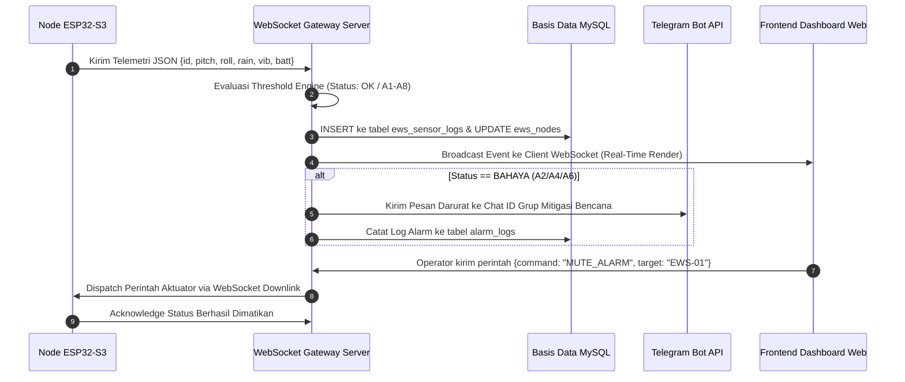

# DOKUMEN TEKNIS SISTEM INTEGRASI EWS TANAH LONGSOR & PERANGKAP HAMA CERDAS
**Dokumen Spesifikasi Teknis, Desain Hardware PCB, Firmware ESP32-S3, Backend IoT, dan Frontend Web Monitoring**

---

| Parameter Dokumen | Informasi |
| :--- | :--- |
| **Judul Sistem** | Landslide Early Warning System (EWS) & Smart Pest Trap Telemetry Platform |
| **Klasifikasi Dokumen** | Dokumen Teknis Arsitektur & Rekayasa Lapangan (Engineering & Technical Specification) |
| **Target Pembaca** | Teknisi Elektronika, Field Engineer, Software Developer, System Administrator BPBD |
| **Jumlah Titik Pantau** | 4 Unit Node EWS Tanah Longsor & 5 Unit Perangkap Hama Bertenaga Surya |
| **Mikrokontroler Utama** | ESP32-S3 (ESP32S3N16R8) Dual-Core Tensilica Xtensa LX7 @ 240 MHz |
| **Konektivitas Data** | Jaringan Seluler GSM/4G (Modem SIMCom A7670C) & Wi-Fi Dual Fallback |
| **Protokol Transmisi** | WebSocket Duplex (`ws://` / `wss://`) & REST API JSON-RPC |
| **Stack Backend** | Node.js (Express.js), WebSocket Server (`ws`), Database MySQL / MariaDB |
| **Stack Frontend** | Next.js 16 (App Router), React 19, TypeScript, Tailwind CSS, Leaflet GIS |
| **Tanggal Pembaruan** | Oktober 2026 |

---

## 1. Arsitektur Global Sistem

Sistem ini mengintegrasikan pemantauan mitigasi bencana geologi (tanah longsor) dan perlindungan komoditas pertanian berbasis IoT (*Internet of Things*). Arsitektur dirancang dengan prinsip **ketersediaan tinggi (high availability)** dan **desentralisasi keamanan (local fail-safe)**:

```
┌─────────────────────────────────────────────────────────────────────────┐
│                      PERANGKAT LAPANGAN (EDGE HARDWARE)                 │
│                                                                         │
│  [Node EWS 01 - 04]                          [Perangkap Hama 01 - 05]   │
│  - ESP32-S3 Dual-Core                        - Solar Trap Controller    │
│  - MPU-6050 Dual-Axis (Tilt/Inclinometer)    - Solar Cell 20 Wp         │
│  - Tipping Bucket (Rain Gauge 0.2mm)         - UV/LED Attractant        │
│  - Vibration Sensor 801S                     - High Voltage Grid / Trap │
│  - Soil Moisture & Temperature Probe         - Counter Telemetry        │
│  - INA226 Power Monitor (Battery & Solar)    - Baterai LiFePO4 / Aki    │
│  - Sirene 12V (115 dB) & Strobo Merah/Kuning                            │
│  - MicroSD Logging + DS3231 RTC                                         │
└────────────────────────────────────┬────────────────────────────────────┘
                                     │
           Koneksi GSM/4G / WiFi     │ WebSocket Duplex (Port 5000/3440)
                                     ▼
┌─────────────────────────────────────────────────────────────────────────┐
│                     SERVER IOT GATEWAY & TELEMETRY ENGINE               │
│                                                                         │
│  - Express REST API & WebSocket Server (`ws` protocol)                  │
│  - Telemetry Engine (Evaluasi Real-Time Status OK, A1 - A8)             │
│  - Persistent Logger (Histori Sensor, Anomali, Audit Operator)          │
│  - Alert Notification Dispatcher (Telegram Bot API Integration)         │
│  - Database: MySQL / MariaDB (Relasional ACID Compliant)                │
└────────────────────────────────────┬────────────────────────────────────┘
                                     │
           Koneksi HTTPS / WSS       │ WebSocket Client Push & REST JSON
                                     ▼
┌─────────────────────────────────────────────────────────────────────────┐
│                 DASHBOARD WEB MONITORING (NEXT.JS 16)                   │
│                                                                         │
│  - Peta Satelit Interaktif (Posisi Geografis Node EWS & Trap Hama)      │
│  - Live Telemetri (Grafik Kemiringan Pitch/Roll, Hujan, Baterai)        │
│  - Kontrol Aktuator Jarak Jauh (Uji Sirene, Mute Lokal, Reset Alarm)    │
│  - Manajemen Ambang Batas (Threshold Configuration Modal)               │
│  - Manajemen Kuota GSM & Parameter Bot Telegram                         │
└─────────────────────────────────────────────────────────────────────────┘
```

---

## 2. Spesifikasi Hardware & Skematik PCB

### 2.1 Skematik Elektronika EWS (Revisi EWS-45)
Rangkaian PCB EWS dirancang khusus untuk memenuhi standar keandalan tinggi di area luar ruangan (*outdoor outdoor-grade*). 


### 2.2 Alokasi Pinout Mikrokontroler ESP32-S3

Berdasarkan dokumen teknis skematik (`Schematic_EWS45_2026-09-28.pdf`), pemetaan pin mikrokontroler adalah sebagai berikut:

| Simbol Skematik | Pin ESP32-S3 | Tipe I/O | Fungsi / Komponen Terkoneksi | Deskripsi Kerja |
| :--- | :--- | :--- | :--- | :--- |
| **IN2** | `GPIO 46` | Digital Output | Driver Relay Sirine 12V & Strobo | Active-HIGH; Menyalakan relay alarm terpadu ketika status BAHAYA |
| **Dhujan** | `GPIO 10` | Digital Input | Sensor Hujan Tipping Bucket | Terhubung ke reed-switch; 1 pulsa = 0.2 mm air hujan |
| **Dgetar** | `GPIO 7` | Digital Input | Sensor Getaran Shock 801S | Interrupt getaran tanah/gempa mikro; filter debounce internal |
| **Ktanah** | `GPIO 17` | Analog Input | Sensor Kelembapan Tanah (ADC2_CH6) | Membaca resistansi/kapasitansi tanah (0 - 4095 ADC) |
| **SDAoled** | `GPIO 8` | I2C Data | Layar OLED 1.3" 128x64 | Menampilkan status lokal, IP address, tegangan baterai, dan sensor |
| **SCLoled** | `GPIO 9` | I2C Clock | Layar OLED 1.3" 128x64 | Bus I2C primer (Frekuensi 400 kHz) |
| **SDAMpu** | `GPIO 11` | I2C Data | Inclinometer MPU-6050 (Bus Terpisah) | Membaca kemiringan lereng sumbu X (Pitch) dan sumbu Y (Roll) |
| **SCLMpu** | `GPIO 12` | I2C Clock | Inclinometer MPU-6050 (Bus Terpisah) | Jalur I2C hardware terisolasi untuk stabilitas membaca akselerasi |
| **SCL2 / SDA**| `GPIO 13` | I2C Data | INA226 Power Monitor Module | Membaca arus (mA) dan tegangan baterai (V) |
| **SDA2 / SCL**| `GPIO 14` | I2C Clock | INA226 Power Monitor Module | Bus I2C sekunder dengan proteksi pull-up resistor |
| **SDAds** | `GPIO 15` | I2C Data | DS3231 High Precision RTC | Penyimpan waktu akurat saat node mati daya atau tanpa internet |
| **SCLds** | `GPIO 16` | I2C Clock | DS3231 High Precision RTC | Terkoneksi baterai kancing CR2032 backup |
| **CS** | `GPIO 6` | SPI Chip Select| Modul MicroSD Card | Penyimpanan log telemetri lokal (*blackbox logging*) |
| **SCK** | `GPIO 5` | SPI Clock | Modul MicroSD Card | Bus SPI kecepatan tinggi |
| **MOSI** | `GPIO 4` | SPI MOSI | Modul MicroSD Card | Master Out Slave In |
| **MISO** | `GPIO 2` | SPI MISO | Modul MicroSD Card | Master In Slave Out |

### 2.3 Sistem Catu Daya & Proteksi Mandiri
1. **Solar Harvesting**: Setiap titik EWS ditenagai oleh panel surya monokristalin 30 Wp dengan Solar Charge Controller (SCC) cerdas.
2. **Penyimpanan Energi**: Baterai aki/VRLA deep-cycle 12V 12Ah - 18Ah dengan kapasitas cadangan minimal 3 hari hujan terus menerus tanpa sinar matahari (*3 days autonomy*).
3. **Regulasi Tegangan**:
   - Rel 12V: Mensuplai langsung sirine alarm 115 dB, lampu strobo, dan input SCC.
   - Rel 5V (Buck Converter LM2596/MP1584): Mensuplai modul relay, modem GSM A7670C, dan modul SD card.
   - Rel 3.3V (LDO AMS1117-3.3): Mensuplai mikrokontroler ESP32-S3, sensor MPU-6050, sensor 801S, dan layar OLED.
4. **Proteksi Sirkuit**:
   - Dioda flyback 1N4007 / SS34 pada koil relay untuk meredam lonjakan EMF balik.
   - Kapasitor elko 1000 µF / 25V pada rel daya utama untuk menyaring drop tegangan saat transmisi modem GSM berdaya puncak tinggi.
   - Sekring otomotif (*blade fuse*) 5A pada input baterai dan 2A pada jalur sirine.
   - Enclosure box bersertifikasi IP65 dengan *cable gland* PG7/PG9 berstandar IP68.

---

## 3. Firmware ESP32-S3 & Logika Multitasking FreeRTOS

Firmware EWS (`esp_32.ino`) dibangun di atas arsitektur dual-core FreeRTOS untuk menjamin responsivitas tinggi antara pembacaan sensor berkala dan pengiriman data jaringan tanpa saling menghambat (*non-blocking*).

```
┌────────────────────────────────────────────────────────────────────────┐
│                        CORE 0 (NETWORK & PROTOCOL ENGINE)              │
│                                                                        │
│  [Task WebSocket Client & Network]                                     │
│  - Memelihara koneksi TCP/SSL ke Gateway Server                        │
│  - Auto-reconnect & PING/PONG heartbeat berkala (interval 10 detik)    │
│  - Menerima perintah kontrol (Remote Mute, Alarm Test, Sync Waktu)     │
│  - Dilindungi Mutex: `wsMutex`                                         │
└───────────────────────────────────┬────────────────────────────────────┘
                                    │ Sinkronisasi Data (`dataMutex`)
┌───────────────────────────────────▼────────────────────────────────────┐
│                        CORE 1 (SENSOR & LOGIKA ALARM)                  │
│                                                                        │
│  [Task Sensor Acquisition & Filtering]                                 │
│  - Akuisisi MPU-6050 (Filter Moving Average 10 sampel pitch/roll)      │
│  - Hitung curah hujan kumulatif & intensitas per jam (Tipping Bucket)  │
│  - Akumulasi pulsa getaran 801S melalui critical section `vibMux`      │
│  - Monitor arus & tegangan baterai via INA226                          │
│                                                                        │
│  [Task Alarm Engine & Local Fail-Safe]                                 │
│  - Evaluasi threshold secara mandiri (BAHAYA / SIAGA / AMAN)           │
│  - Trigger relay lokal GPIO 46 jika lereng miring atau hujan lebat     │
│  - Sirene TETAP BUNYI meski koneksi internet/server terputus           │
│                                                                        │
│  [Task Local Data Logger]                                              │
│  - Tulis histori CSV ke MicroSD Card berkala                           │
│  - Fallback ke SPIFFS flash memory jika SD Card rusak atau penuh       │
└────────────────────────────────────────────────────────────────────────┘
```

### 3.1 Tabel Kode Status & Anomali Sistem
Sistem telemetri menggunakan format status kode ringkas untuk transmisi hemat bandwidth:

| Kode Anomali | Status | Ambang Batas Evaluasi | Respon Sistem & Aktuator |
| :---: | :---: | :--- | :--- |
| **OK** | Normal / Aman | Seluruh sensor dalam batas normal | Sirene OFF, Strobo OFF, LED Hijau kedip 2s |
| **A1** | Baterai Lemah | Tegangan baterai < 11.20 V | Peringatan di dashboard, notifikasi bot Telegram teknisi |
| **A2** | Bahaya Longsor | Sudut Pitch / Roll $\ge$ Ambang Bahaya ($> 15.0^{\circ}$) | **Sirene ON (115 dB), Strobo Merah ON**, sirine lokal terkunci |
| **A3** | Siaga Longsor | Sudut Pitch / Roll $\ge$ Ambang Siaga ($> 8.0^{\circ}$) | Peringatan oranye di dashboard, notifikasi Telegram Level 2 |
| **A4** | Bahaya Hujan | Curah hujan intensif $\ge$ 50.0 mm/jam | **Sirene ON**, evakuasi lereng jenuh air |
| **A5** | Siaga Hujan | Curah hujan intensif $\ge$ 20.0 mm/jam | Peringatan waspada banjir/longsor di dashboard |
| **A6** | Bahaya Getaran | Pulsa getaran getar $\ge$ Ambang Bahaya | **Sirene ON**, indikasi rekahan atau gempa aktif |
| **A7** | Siaga Tanah | Kelembapan tanah $\ge$ 85% (jenuh air) | Rekomendasi patroli lapangan |
| **A8** | Filter Getaran | Getaran sesaat (tahap verifikasi persistensi) | Verifikasi 3 siklus untuk menghindari *false positive* |

---

## 4. Arsitektur Backend (Node.js Express & WebSocket)

Backend bertanggung jawab sebagai sentral kendali, gateway komunikasi dua arah, dan pengelola basis data relasional.

### 4.1 Alur Transmisi Data


### 4.2 Struktur Tabel Database Utama (MySQL)
1. **`ews_nodes`**: Menyimpan konfigurasi 4 titik pantau, koordinat latitude/longitude, status online/offline, dan ambang batas sensor.
2. **`ews_sensor_logs`**: Menyimpan seluruh riwayat pengukuran telemetri (waktu milidetik, pitch, roll, rain, vibration, voltage, current).
3. **`pest_traps` & `trap_logs`**: Menyimpan status 5 unit perangkap hama bertenaga surya, status lampu UV/LED pemikat hama, dan jumlah hitungan hama terperangkap.
4. **`alarm_logs`**: Menyimpan catatan audit kapan sirene menyala, penyebab pemicu (trigger cause), serta nama operator yang melakukan konfirmasi (*acknowledgement*).
5. **`telegram_configs`**: Konfigurasi token bot, chat ID grup, dan filter level notifikasi darurat.

---

## 5. Arsitektur Frontend (Next.js 16 Web Monitoring)

Frontend dirancang dengan antarmuka modern menggunakan **Next.js 16**, **React 19**, **Tailwind CSS**, dan peta interaktif berbasis GIS.


### 5.1 Modul-Modul Utama Antarmuka
1. **Overview & Satellite Map (`/overview`)**:
   - Menampilkan peta satelit real-time dengan marker posisi 4 titik EWS dan 5 titik perangkap hama.
   - Marker dilengkapi animasi gelombang (*pulsing dot*) berwarna hijau, kuning, atau merah sesuai status bahaya.
2. **Detail Node Sensor (`/ews/[id]`)**:
   - Menampilkan instrumen pengukur sudut inklinometer dual-axis (visualisasi gelembung kemiringan).
   - Grafik riwayat curah hujan, intensitas getaran, dan kelembapan tanah.
   - Status tegangan baterai dan daya panel surya dari sensor INA226.
   - Tombol operasional: Uji Sirine (Test Alarm), Mute Suara, dan Kalibrasi Titik Nol (*Zero Tare*).
3. **Monitoring Perangkap Hama (`/traps`)**:
   - Menampilkan kondisi 5 unit perangkap serangga bertenaga surya, status tegangan baterai masing-masing unit, dan statistik populasi hama yang terperangkap per hari.
4. **Riwayat Alarm & Log Anomali (`/alarms`)**:
   - Tabulasi audit trail yang merekam tanggal, jam, durasi alarm berbunyi, dan penyebab anomali.
5. **Pengaturan Sistem (`/settings`)**:
   - Konfigurasi ambang batas kemiringan, curah hujan, token Telegram, nomor modem Telkomsel, dan manajemen hak akses pengguna.

---

## 6. Prosedur Kalibrasi, Commissioning & Pemeliharaan

### 6.1 Kalibrasi Nol Sensor Kemiringan (MPU-6050 Zero Tare)
1. Pasang box controller pada tiang pipa baja secara kokoh dan pastikan tiang berdiri tegak lurus sempurna menggunakan *waterpass* presisi.
2. Buka serial monitor ESP32 (baudrate 115200) atau akses menu **Engineering Docs / Kalibrasi** pada Web Dashboard.
3. Tekan perintah `TARE_ZERO`. Nilai offset sumbu X dan Y akan disimpan secara permanen ke dalam memori Non-Volatile Storage (NVS) ESP32 sehingga posisi tiang saat itu bernilai $0.00^\circ$.

### 6.2 Uji Rutin Tipping Bucket & Sensor Getaran
1. Bersihkan corong *rain gauge* dari daun kering, lumut, atau serangga setiap 1 bulan sekali.
2. Berikan tetesan air terukur sebanyak 20 ml untuk memastikan ayunan *bucket* berayun lancar dan pulsa reed switch terbaca di mikrokontroler.
3. Lakukan pengetukan ringan pada tiang untuk memastikan sensor 801S membaca getaran dan memicu indikator LED pada PCB.

### 6.3 Pemeliharaan Sistem Daya Baterai
1. Periksa tegangan mengambang (*float voltage*) aki saat tengah hari (rentang ideal 13.6V - 14.2V saat terpapar sinar matahari terik).
2. Lap permukaan kaca panel surya 30 Wp menggunakan kain microfiber lembap untuk mencegah penurunan efisiensi fotovoltaik akibat debu atau kotoran burung.
3. Pastikan indikator INA226 pada dashboard menampilkan arus masuk positif saat siang hari.
